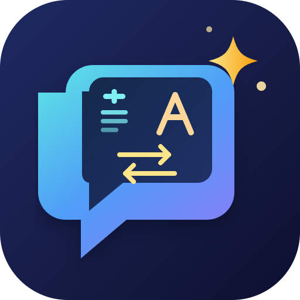
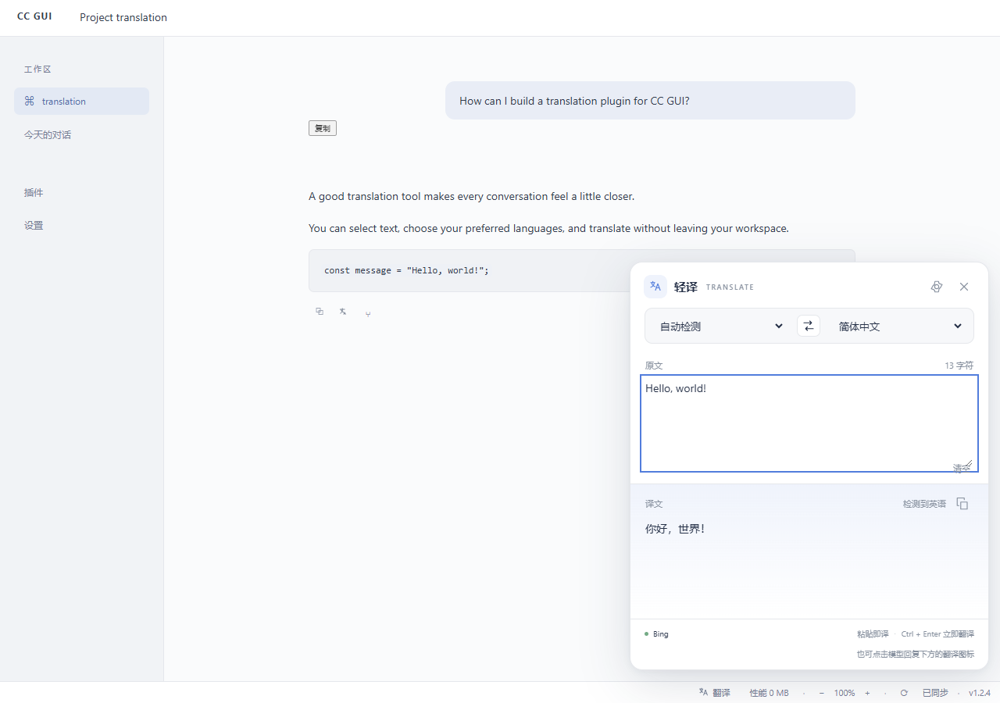

<p align="center">
  
</p>

# 轻译 · CC GUI 桌面翻译插件

选中文字右键翻译，或点击右下角「翻译」粘贴文字，自动获得译文。支持 Bing、Google、百度翻译、阿里云机器翻译、有道智云，以及 OpenAI 兼容的 Responses / Chat Completions 供应商。



## 安装

**从市场安装（推荐）**：CC GUI 侧边栏「插件」→ 市场，搜索「轻译」一键安装，后续版本自动提示更新。

**从本地目录安装**：在 CC GUI 的「插件」→「从本地目录安装」中选择本项目的 **plugin** 目录（包含 manifest.json 的那一层）。需要 SDK 0.3.25 或更高的兼容 0.3 版本。

首次使用默认「自动检测 → 简体中文 / Bing」。点击语言下拉框选择语言，中间按钮交换方向；当源语言为自动检测时，使用最近检测到的语言作为交换后的目标，无检测结果时使用英语（目标原为英语时使用简体中文）。有译文时，互换会把译文放入输入框继续反向翻译。

输入后等待 600ms 自动翻译，Ctrl+Enter 立即翻译。右上角齿轮直接打开插件设置。Esc 关闭面板或菜单。

## 自定义 AI

在插件设置中选择「自定义 AI」，填写 Base URL、API Key 和协议。模型名旁的「拉取模型列表」会读取供应商兼容的 `/models` 接口；之后在模型名称框输入时会自动匹配已拉取的模型（↑↓ 选择、回车确认），没有匹配时直接回车即使用自定义名称。点击「测试连接」，然后「保存设置」。本机无认证服务可不填 API Key。

设置中的「翻译风格」决定系统提示的口吻与约束，五种可选：**通用**（自然准确，适合大多数场景）、**口语**（随意的日常表达）、**书面**（公文、法律、商务的正式语体）、**技术**（术语准确，代码与标识符原样保留）、**严格**（约束最强，只输出译文，不作答也不展开）。风格只影响发给模型的指令，不改变语言选择与引擎行为。

## 配置百度、阿里云和有道翻译

在「轻译设置 → 翻译引擎」选中对应服务，按页面中的申请流程获取凭证并填写，点击「测试连接」确认成功后保存。三家凭证分别保存在本机插件存储中（不是系统加密保险库）；请求只发往所选服务，插件在本机生成签名，不会把密钥写入日志。

- **百度翻译**：打开[百度翻译开放平台开发者管理](https://fanyi-api.baidu.com/manage/developer)，登录并完成开发者注册，在管理控制台开通「通用翻译 API」并创建应用。进入开发者信息复制 **APP ID** 和 **密钥**，分别填入设置。插件调用通用翻译 HTTPS 接口，使用 MD5 签名。
- **阿里云翻译**：打开[阿里云机器翻译产品页](https://www.aliyun.com/product/ai/alimt)并在控制台开通通用版。建议在 [RAM 用户管理](https://ram.console.aliyun.com/users)创建专用 RAM 用户、开启 OpenAPI 调用访问，并仅授予调用机器翻译 `TranslateGeneral` 所需权限；再到 [AccessKey 管理](https://ram.console.aliyun.com/manage/ak)为该 RAM 用户创建凭证。将 **AccessKey ID** 和 **AccessKey Secret** 分别填入设置。插件使用杭州地域 REST 接口并在本机生成 HMAC-SHA1 签名。
- **有道翻译**：打开[有道智云 AI 开放平台](https://ai.youdao.com/)注册并登录，[前往控制台](https://ai.youdao.com/console/)，进入应用管理创建应用，选择自然语言翻译的「文本翻译」服务和 API 接入方式。应用创建后，在应用总览复制 **应用 ID（APP Key）** 与 **应用密钥（APP Secret）** 并分别填入设置。插件使用文本翻译 API v3 签名。

三种服务需要各自在供应商控制台开通并按账户规则计费或使用配额。目标语言必须受所选服务支持；如果设置页的「测试连接」提示语言方向不受支持，请换用该平台支持的语言代码或服务。

当前预置服务地址包括 `api.openai.com`、`token.sensenova.cn`、三家翻译 API、`localhost` 和 `127.0.0.1`。CC GUI 当前版本对插件网络请求实行主机名精确授权，不支持插件运行时动态授权任意供应商域名；其他供应商暂时需要插件维护者在后续版本中加入支持。

## 回复翻译

模型回复结束后，回复左下角会显示复制和创建分支图标。翻译图标紧挨复制图标。点击后只翻译这一条已完成的回复。

- 译文显示在该回复正文下方。原文保持不动；代码块、行内代码、文件路径与标识符在译文中原位保留，其中代码内容不会发给翻译引擎。代码位置用编号占位符传递，模型漏掉的占位符会补在译文末尾，不会被静默删除。
- 再点一次翻译图标收起译文，再点一次重新显示，不会重复请求。正在翻译时可以停止；失败时可以重试。
- 正在生成的回复不显示翻译图标。回复正文被修改后，旧译文会去掉。
- 切换会话后，未完成的请求会被丢弃。译文只保存在内存中。更换语言后需要重新翻译。

AI 翻译将原文放进一条明确的翻译请求里（`Translate the following text into <目标语言> (output the translation only):` 加原文）再发送，系统提示说明翻译方向、风格和「只输出译文」。这样即使只粘一段短语，模型也会把它当待翻译的文本，而不是当成对话去作答或展开。插件仍会保留格式、代码和专有名词。短文本不会因为译文长度或换行而被插件拒绝。模型若仍返回额外说明，插件会按模型返回内容显示；插件不能保证不同模型都严格遵守提示。

原文已经是目标语言时（含源语言为自动检测且识别为同一语言），不会发起请求，直接原样返回并提示“原文已是 X，已原样返回”；简体中文到繁体中文仍会正常请求引擎转换。

当前 SDK 不提供聊天正文按钮和读取接口。本插件按照本项目用户明确授权，使用聊天 DOM 兼容层，只读取当前聊天区域里已完成回复的正文，不读取宿主私有 store 或其他插件数据。适配依据为 SDK 0.3.25 对应客户端的 #center-tabpanel、data-virtual-inner、data-tab-key、message-copy-btn 和 message-fork-btn。客户端升级改动 DOM 时可能需要更新适配。无法识别时不会读取整个页面充当会话。工具输出和思考过程没有这对图标，因此不会翻译。

## 数据和网络

需要翻译的文字会发往用户选择的引擎。API Key 仅保存在本机插件独立 storage 中，默认掩码展示；该存储不是系统加密保险库。插件不记录密钥、供应商错误正文或聊天原文。Responses 请求显式设置 store:false；供应商实际数据政策以该供应商为准。

Bing / Google 使用其网页翻译接口，无需密钥，可能受到地区、限流或接口变更影响。Google 需要可访问其服务的网络。百度、阿里云和有道使用用户自行申请的 API 凭证；文本和翻译方向会发送至所选供应商。所有运行时网络请求经 CC GUI 的 plugin_http_request 发出，沿用宿主网络行为，单次请求有宿主超时上限。

## 开发与验证

```powershell
npm ci
npm test
npm run build
npm run test:browser
npm run test:live
```

发布：升 `manifest.json` 与 `package.json` 的 `version`，打与 version 完全一致的 tag 并推送（无 `v` 前缀），`.github/workflows/release.yml` 会从源码构建并把 `main.js` / `manifest.json` / `styles.css` 附加到该 Release。

```powershell
git tag 1.0.0
git push origin 1.0.0
```

main.js 为 esbuild 生成的单文件 ESM，无外部运行依赖，使用宿主 ctx.react。只修改 src / styles.css 后重新构建，不要直接修改生成的 main.js。浏览器测试使用本机 Chrome（可用 CHROME_PATH 指定路径），模拟 SDK bridge 验证界面交互；实际宿主和供应商联调仍以 CC GUI 为准。

重新安装：再次选择同一 plugin 目录，宿主会覆盖并热重载，无需重启。卸载：在插件页面卸载「轻译」；宿主默认保留插件数据 30 天。
